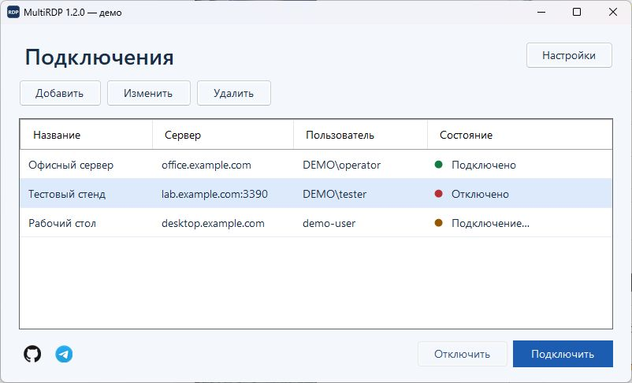

# MultiRDP

MultiRDP — небольшая утилита для управления RDP-подключениями в Windows. Она хранит параметры каждого подключения отдельно, поэтому к одному серверу можно подключаться под разными учётными записями. Утилита использует встроенный компонент удалённого рабочего стола Windows.



## Скачать

[Релизы MultiRDP](https://github.com/ezh-HaMMeR/multirdp/releases)

Скачайте `MultiRdp.exe` из нужного релиза и запустите его. Установка и права администратора не нужны. Сборка проверялась на Windows 11. Совместимость с Windows 10 22H2 не проверялась на практике.

## Возможности

- Несколько профилей с отдельными адресами, портами, логинами и паролями.
- Разрешения для каждого профиля на перенаправление смарт-карт и Windows Hello для бизнеса, WebAuthn, дисков, буфера обмена и принтеров.
- Индикаторы сеанса. Зелёный означает успешный вход, жёлтый — подключение или переподключение, красный — отсутствие подключения.
- Компактная таблица с одной кнопкой для подключения или отключения выбранного профиля.
- Ширина столбцов подбирается по содержимому. Размер окна и ширина столбцов, заданная вручную, сохраняются при закрытии окна.
- Сортировка по колонкам и ручная перестановка строк. Выбранный порядок сохраняется между запусками.
- Сворачивание в трей при закрытии окна, автозапуск с Windows и запуск сразу в трей.

## Как пользоваться

1. Нажмите **Добавить** и укажите название, адрес сервера и имя пользователя. Нестандартный порт можно указать через двоеточие, например `server.example.com:3390`.
2. При необходимости сохраните пароль и настройте разрешения. Если оставить поле пароля пустым, его запросит Windows. Все пять разрешений в новом профиле включены по умолчанию.
3. Выберите профиль и нажмите **Подключить**. Для открытого подключения эта же кнопка меняется на **Отключить**. Сессия на сервере может остаться в отключённом состоянии.

Щелчки по заголовку одной колонки переключают сортировку по возрастанию, по убыванию и ручной порядок. Чтобы поменять два подключения местами, перетащите одну строку на другую.

Профили хранятся в `%LOCALAPPDATA%\MultiRdp\profiles.xml`. Пароли защищены Windows DPAPI с привязкой к текущей учётной записи Windows. Windows может запросить подтверждение подлинности сервера или повторный ввод пароля в зависимости от настроек клиента и сервера.

## Сборка из исходников

Проект написан на C# и WinForms. Скрипт использует компилятор .NET Framework из Windows. Запустите в PowerShell из корня репозитория:

```powershell
.\build.ps1
```

Файл появится в папке `dist` под именем `MultiRdp.exe`.

## Обратная связь

- [Сообщить об ошибке](https://github.com/ezh-HaMMeR/multirdp/issues)
- [Автор в Telegram](https://t.me/freaksty1e)
